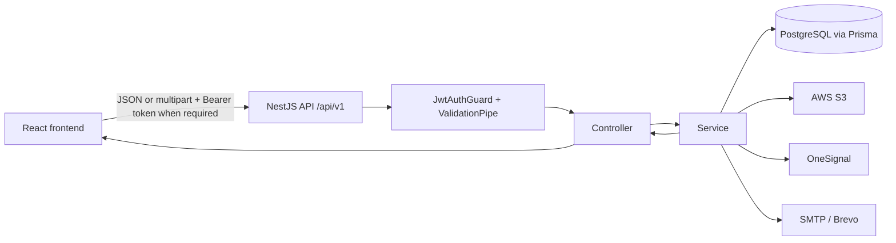
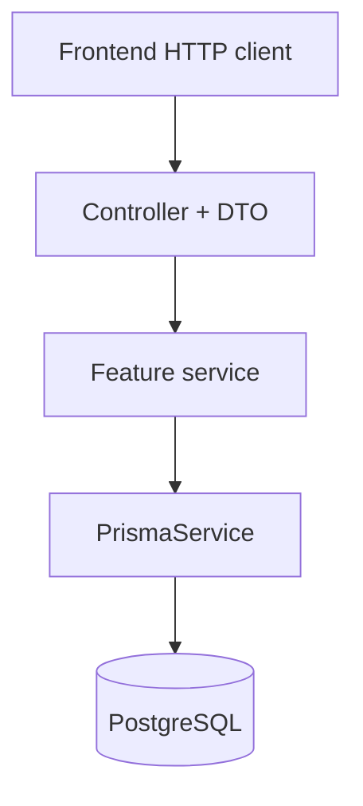
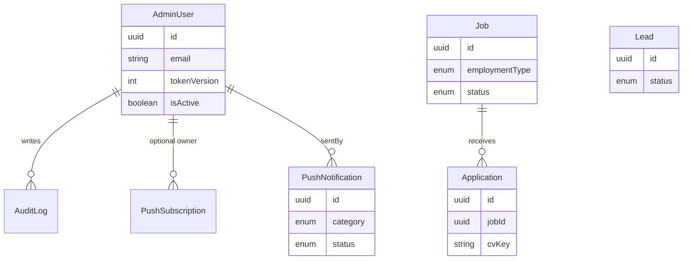

# Backend Context for Frontend Development

This document is the architectural introduction to the Thijar website backend. It explains how the NestJS API is structured, how it authenticates and authorizes requests, how data and files are stored, and how a React frontend should integrate with it.

**This is not API endpoint documentation.** Request and response contracts, status codes, and per-route examples belong in the existing module API documentation. Use this file as persistent context for frontend work and for Cursor Agent tasks.

---

## 1. Backend Overview

The backend is the server for the Thijar company website and its admin panel. It is responsible for:

- Authenticating admin users and protecting admin operations.
- Serving public website content (contact details, client logos, job listings, ERP installer download, web-app link).
- Accepting public submissions (contact-us leads and job applications).
- Persisting content and submissions in PostgreSQL.
- Storing files in a private AWS S3 bucket and issuing short-lived download URLs.
- Sending admin email alerts for new leads.
- Sending browser push notifications through OneSignal and recording send history.

The React frontend never talks to PostgreSQL, S3, SMTP, or OneSignal’s REST API directly. It talks only to this HTTP API. The backend owns validation, authorization, persistence, and external-service credentials.

### Request flow



Typical path of a request:

1. Helmet adds security headers. CORS is checked against `CORS_ORIGIN`.
2. The global prefix `api/v1` is applied.
3. `ThrottlerGuard` applies rate limits.
4. `JwtAuthGuard` allows `@Public()` routes; every other route must present a valid admin Bearer token.
5. `ValidationPipe` validates and transforms the body/query against the DTO.
6. The controller extracts params, files, and the current admin, then calls a service.
7. The service uses Prisma and, when needed, S3, email, or OneSignal.
8. `AllExceptionsFilter` shapes HTTP errors.

Data is stored in PostgreSQL. File bytes are never stored in the database; only object keys and metadata are stored. External services are invoked from dedicated services (`S3Service`, `EmailService`, `OneSignalService`).

---

## 2. Technology Stack

Verified from `package.json` and source. Versions are those declared in package configuration.

| Technology | Version (declared) | Role |
| --- | --- | --- |
| NestJS (`@nestjs/common`, `core`, `platform-express`) | `^11.0.1` | HTTP application framework |
| TypeScript | `^5.7.3` | Language |
| PostgreSQL | via Prisma datasource | Primary database |
| Prisma ORM (`prisma`, `@prisma/client`) | `^6.19.3` | Schema, migrations, queries |
| `@nestjs/jwt` | `^11.0.0` | JWT access tokens (HS256) |
| `bcrypt` | `^6.0.0` | Admin password hashing (12 rounds) |
| `class-validator` | `^0.14.2` | DTO validation |
| `class-transformer` | `^0.5.1` | Payload transformation |
| `joi` | `^18.1.2` | Startup environment validation |
| `@nestjs/swagger` | `^11.2.6` | OpenAPI UI in development |
| `@nestjs/config` | `^4.0.2` | Environment configuration |
| `@nestjs/throttler` | `^6.5.0` | Rate limiting |
| Helmet | `^8.1.0` | HTTP security headers |
| AWS SDK v3 (`client-s3`, `lib-storage`, `s3-request-presigner`) | `3.817.0` / `^3.817.0` | Private S3 upload, delete, presigned GET |
| `file-type` | `^22.3.0` | Magic-byte checks for images and PDFs |
| `nodemailer` | `^10.6.1` | SMTP email (comments refer to Brevo) |
| `@nestjs/axios` + `axios` | `^12.0.2` / `^1.21.1` | OneSignal HTTP client |
| Multer (via NestJS) | types `@types/multer` `^1.4.12` | Multipart uploads |

Also present and used:

- `@nestjs/mapped-types` for `PartialType` DTOs.
- Node `crypto` for HMAC-signed pagination cursors and file names.

Declared in `package.json` but **not used** by current `src/` application modules: `@nestjs/schedule`, `puppeteer`, `exceljs`, `xlsx`, `qrcode`, `sanitize-html`, and the `crypto` npm package (Node’s built-in `crypto` is used instead). Do not assume those features exist in the API.

The npm package name is still `thijar-currency-monitor`. Swagger’s title is still “Thijar Currency Monitor API”. Treat those as leftover names; the running product is the Thijar website backend.

---

## 3. Backend Project Structure

The application is a NestJS modular API. Frontend developers do not need the full tree; they need the boundaries below.

### Bootstrap and composition

- `src/main.ts` — Helmet, CORS, global prefix, ValidationPipe, exception filter, Swagger (development only), listen port.
- `src/app.module.ts` — Wires Config, Database, Core, Auth, feature modules, JWT, Multer memory storage, and global throttling.
- `src/config/env.validation.ts` — Joi schema for required environment variables at startup.

### Core security

- `src/core/core.module.ts` — Registers `JwtAuthGuard` as a global `APP_GUARD`.
- `src/core/guards/jwt-auth.guard.ts` — Enforces admin JWT unless `@Public()`.
- `src/core/decorators/public.decorator.ts` — Marks unauthenticated routes.
- `src/core/decorators/admin-route.decorator.ts` — Swagger grouping, Bearer auth in docs, and a higher admin rate limit. **It does not implement permission checks.**
- `src/core/decorators/current-admin.decorator.ts` — Injects the authenticated admin into handlers.
- `src/core/session.config.ts` — Access-token TTL and maximum session length.
- `src/core/interfaces/jwt-payload.interface.ts` — JWT claims and request-scoped admin type.

### Database

- `prisma/schema.prisma` — Models, enums, relations, indexes.
- `prisma/migrations/` — Applied PostgreSQL migrations.
- `src/database/prisma.service.ts` — Nest wrapper around `PrismaClient`.
- `src/database/database.module.ts` — Exports `PrismaService`.

### Feature modules (`src/modules/`)

Each module typically has a controller, a service, DTOs, and a Nest module file.

| Module | Responsibility |
| --- | --- |
| `auth` | Admin login, refresh, logout, current admin (`/admin/auth/...`) |
| `contact-info` | Public and admin contact details |
| `client-logos` | Public and admin client logos and image files |
| `erp-details` | ERP installer upload/download and the public web-app link |
| `job-listing` | Public and admin job listings |
| `job-applicaiton` | Public job applications; admin list/detail/CV download/delete (folder name is misspelled) |
| `leads` | Public contact-form submissions; admin lead management |
| `push-notification` | Admin send/list/detail of OneSignal notifications (`push-nofification.module.ts` is misspelled) |

Controllers accept HTTP and return DTOs. Services contain business rules and Prisma/S3/email/OneSignal calls. DTOs define the request contract the frontend must match.

Path style: several controllers use `@Controller()` with full paths on each method (`public/...`, `admin/...`). Auth uses `@Controller('admin/auth')`. Public job, lead, application, installer download, and web-link routes do **not** all sit under a single `public/` prefix. Use the existing API documentation for exact paths.

### Shared layer

- `src/shared/shared.module.ts` — Global `PaginationService` and `AuditService`.
- `src/shared/utils/S3.service.ts` — S3 client, uploads, deletes, presigned URLs.
- `src/shared/email/` — Nodemailer SMTP service (imported by Leads, not global).
- `src/shared/filters/http-exception.filter.ts` — Global exception shaping.
- `src/shared/handlers/validation-exception.handler.ts` — Field-error factory (defined, not currently wired).
- `src/shared/dtos/pagination-query.dto.ts` — Shared `limit` + `cursor` query.
- `src/shared/utils/throttle.constant.ts` — Named rate-limit presets.
- Upload helpers for installers and CVs.

### Scripts

- `src/scripts/create-admin.ts` — CLI to create the first admin (`npm run create-admin`). There is no public registration.

### How the pieces interact



A controller never queries Prisma directly in the current modules. The frontend never imports Prisma types from this repo; it should copy or generate TypeScript interfaces from the **API documentation**, not from the Prisma schema.

---

## 4. API Communication Architecture

### Global prefix and base URL

Every application route is under:

```text
{ORIGIN}/api/v1/{path}
```

`PORT` defaults to `3000` if unset. In local development that is typically `http://localhost:3000/api/v1`.

The frontend should treat the API origin as configuration, then append `/api/v1`. For a Vite React app:

```bash
# .env.development
VITE_API_BASE_URL=http://localhost:3000/api/v1

# .env.production
VITE_API_BASE_URL=https://api.example.com/api/v1
```

```ts
const api = fetch(`${import.meta.env.VITE_API_BASE_URL}/admin/auth/me`, { ... });
```

Do not hard-code hosts. Production origin must match the backend `CORS_ORIGIN` value.

### HTTP and payloads

- JSON bodies: `Content-Type: application/json`.
- File uploads: `multipart/form-data` (client logos, ERP installer, job-application CV). Field names are defined per endpoint in the API documentation (`image`, `file`, `cv`, plus text fields).
- Query parameters for pagination: `limit`, `cursor`.
- Authenticated requests: `Authorization: Bearer <accessToken>`.
- Also allowed by CORS: `Content-Type`, `Authorization`, `X-Requested-With`, `Accept`, `Origin`.

### CORS

Configured in `main.ts`:

- `origin`: `process.env.CORS_ORIGIN` (a single origin string).
- Methods: GET, POST, PUT, DELETE, OPTIONS, PATCH.
- `credentials: true`.

The API does **not** set auth cookies. `credentials: true` allows a cookie-capable client, but the implemented contract is the Authorization header. The frontend origin must match `CORS_ORIGIN` exactly.

### Development versus production

| | Development (`NODE_ENV=development`) | Production (`NODE_ENV=production`) |
| --- | --- | --- |
| Swagger | Served at `/docs` (not under `/api/v1`) | Not registered |
| CORS | Frontend Vite origin | Deployed frontend origin |
| Database / JWT / AWS | Local or shared `.env` | Production secrets |

Swagger is a development tool. Frontend integration should use the module API documentation as the source of truth; Swagger can help explore the live server locally.

### Rate limiting

- Global default: **100 requests per 60 seconds** per client.
- `@AdminRoute()` handlers: **600 per 60 seconds**.
- Login: **5 attempts per 15 minutes**.

Named presets `leadSubmit` and `applicationSubmit` exist in `throttle.constant.ts` but are **not applied** to those public routes. Public submissions currently fall under the global 100/minute limit.

### Root route

`GET /api/v1` (`AppController`) is **not** marked `@Public()`. A browser or health check without a token receives 401. Do not use it as a public health endpoint.

---

## 5. Authentication Architecture

Authentication is **admin-only**. Website visitors do not have accounts. Admins are created with `npm run create-admin`, not through the API.

### Login

`POST /api/v1/admin/auth/login` is `@Public()`.

- Email is trimmed and lower-cased in the DTO.
- Password is checked with bcrypt. Missing users, inactive users, and wrong passwords all return the same `401` with `error: "invalid_credentials"`.
- Timing is padded with a dummy bcrypt compare so unknown emails do not fail faster.
- On success, `lastLoginAt` is updated and an access token is issued.

Response contract (shape only; see API docs for examples): `accessToken`, `expiresAt` (ISO UTC), and `admin: { id, email, name }`.

### JWT access tokens

- Algorithm: HS256, signed with `JWT_SECRET`.
- Claims: `sub` (admin id), `ver` (token version), `loginAt` (unix seconds of original sign-in).
- Transport: **Authorization header** `Bearer <accessToken>`. Cookies are not used and are not parsed.
- Default access TTL: `JWT_ACCESS_TTL_SECONDS` (Joi default **3600** seconds / 1 hour).
- Maximum session: `SESSION_MAX_HOURS` (Joi default **8** hours) from original `loginAt`. Refresh never extends past that wall clock.

`expiresAt` on the login/refresh response is when **this** access token expires, not when the 8-hour session ends.

### Refresh

`POST /api/v1/admin/auth/refresh` **requires a still-valid access token**. There is no separate refresh token.

- Issues a new access token with the same `loginAt`.
- New TTL is `min(access TTL, time remaining in the 8-hour window)`.
- If the 8-hour window has ended, returns `401` with `error: "unauthenticated"` and message that the session has ended.

If the current access token is already expired, refresh cannot be called. The frontend must refresh **before** expiry, while the token is still accepted.

### Logout and invalidation

`POST /api/v1/admin/auth/logout` increments `AdminUser.tokenVersion` and returns **204 No Content**.

Every subsequent request with an older `ver` claim fails immediately. There is no token denylist. Invalidation is version-based and applies to **all** tokens for that admin (this device and others).

A disabled admin (`isActive = false`) also fails the guard on every request.

### Current admin

`GET /api/v1/admin/auth/me` returns `{ admin: { id, email, name } }`. Use it to confirm a stored token is still valid after page load.

### How protected requests are validated

On every non-public request, `JwtAuthGuard`:

1. Reads `Authorization: Bearer ...`.
2. Verifies signature and JWT expiry.
3. Rejects if `loginAt + SESSION_MAX_HOURS` has passed.
4. Loads the admin from PostgreSQL.
5. Rejects if missing, inactive, or `tokenVersion !== payload.ver`.
6. Attaches `request.admin` for `@CurrentAdmin()`.

Failed auth is a uniform `401`:

```json
{ "error": "unauthenticated", "message": "Please sign in to continue.", "statusCode": 401, "path": "..." }
```

(The global filter adds `statusCode` and `path`.)

### Frontend responsibilities (contract vs decisions)

**Backend contract (verified):**

- Store and send the access token as a Bearer header.
- Refresh with a valid token before `expiresAt`.
- After 8 hours from original login, require a full login.
- After logout, 401, or failed `/me`, treat the session as ended.
- Do not send cookies for authentication.

**Frontend decisions (not specified by the backend):**

- Where to keep the token (memory, `sessionStorage`, `localStorage`, etc.).
- How to schedule refresh (timer vs interceptor).
- How protected React routes redirect to login.

This document does not recommend a storage strategy.

---

## 6. Authorization and Permissions

### What exists today

There is **no role or permission model**. `AdminUser` has no roles, permissions, or scopes. Any authenticated **active** admin can call any non-public route.

Two route classes:

1. **Public** — `@Public()`. No token. Website reads and public forms.
2. **Authenticated admin** — everything else. Valid Bearer token required.

`@AdminRoute('...')` is documentation and throttling. Arguments such as `'leads:update'` or `'leads:view'` are **Swagger tag strings**, not enforced permissions. Several Swagger descriptions mention HTTP 403 “Forbidden”; the JWT guard returns **401**, not 403, because there is no permission guard.

### How the frontend should treat this

- Gate the **admin app** on authentication state (`/admin/auth/me` or equivalent).
- Do not invent a permission matrix unless the backend adds one.
- Hiding a button in React is never a substitute for backend checks. Today the backend’s check is “valid admin token”, not “this admin may edit leads”. If finer permissions are added later, UI hiding remains cosmetic; the API remains authoritative.

---

## 7. Validation and Error Handling

### ValidationPipe (global)

From `main.ts`:

- `whitelist: true` — properties not declared on the DTO are stripped.
- `forbidNonWhitelisted: true` — extra properties cause **400**.
- `transform: true` with `enableImplicitConversion: true` — query/body values are coerced toward DTO types (for example strings to numbers).
- `stopAtFirstError: true`.
- Custom `exceptionFactory` returns the **first** constraint message as a `BadRequestException` string message (not a field map).

`buildValidationException` in `validation-exception.handler.ts` can return `{ error: 'validation_failed', fieldErrors: { ... } }`, but it is **commented out** and not active. Frontend forms should not assume `fieldErrors` unless a given service builds that shape itself (contact-info kind/value checks do in one case).

### DTO rules the frontend must follow

- Required vs optional is per DTO (`@IsOptional()`).
- Enums must use **exact Prisma string values** (see section 8). Display labels such as “Full-time” are a frontend concern.
- UUIDs in path params typically use `ParseUUIDPipe`.
- Emails, max lengths, and URL protocol rules are enforced in DTOs (for example push-notification `url` requires a protocol).

### File validation

Layered, depending on the upload:

- Multer limits (size, count, disk vs memory).
- Nest `ParseFilePipe` / `FileTypeValidator` for logos (JPEG/PNG/WebP, 2 MB).
- Magic-byte checks via `file-type` in `S3Service` for images and PDFs.
- Installer: `.exe` extension plus MZ/PE header inspection and 500 MB cap.
- CV: PDF MIME + `.pdf` extension, 5 MB, then magic-byte PDF check on upload.

### Exception filter

`AllExceptionsFilter` catches everything:

- `HttpException` → that status and body, plus `statusCode` and `path`.
- Unknown errors → `500` `{ statusCode, message: "Internal server error", path }`.
- 5xx errors are logged server-side.

Frontend handling guidance:

- `400` — fix the request (validation, extra fields, invalid cursor, closed job, etc.).
- `401` — clear session and send the user to login (or show the public site unauthenticated).
- `404` — entity missing.
- `429` — throttling; back off.
- `500` — show a generic failure; do not parse internal messages as form field errors.

Response envelopes are **not uniform**. Some handlers return the resource, some `{ items, nextCursor }`, some `{ message, data }`, some `{ message, created }`. Always follow the module API documentation for that route.

---

## 8. Database Architecture

Prisma connects with `DATABASE_URL`. `PrismaService` connects on module init and disconnects on destroy. Feature services inject `PrismaService` and call `this.prisma.<model>.*`.

**Do not put database credentials in the frontend.** The Prisma schema is a backend concern; the frontend uses API JSON.

### Conventions (verified in schema)

- Table/column names: `snake_case` via `@@map` / `@map`.
- IDs: UUID strings.
- Timestamps: `timestamptz(3)`, UTC, serialized as ISO strings in JSON.
- Files: S3 **keys** in the database, never file bytes.

### Models and purpose

| Model | Table | Purpose |
| --- | --- | --- |
| `AdminUser` | `admin_users` | Admin accounts |
| `AuditLog` | `audit_logs` | Admin action trail (currently written by contact-info) |
| `ClientLogo` | `client_logos` | Client logo metadata + `imageKey` |
| `ContactInfo` | `contact_info` | Contact rows shown on the website |
| `ERPInstallerRelease` | `erp_installer_releases` | ERP installer metadata + `fileKey` |
| `SiteSetting` | `site_settings` | Key/value settings; web link uses key `thijar_web` |
| `Job` | `jobs` | Job listings |
| `Application` | `applications` | Job applications + CV metadata |
| `Lead` | `leads` | Contact-us submissions |
| `PushSubscription` | `push_subscriptions` | Schema for browser push endpoints (**unused by application code**) |
| `PushNotification` | `push_notifications` | OneSignal send history |

### Enums (send these exact strings)

| Enum | Values |
| --- | --- |
| `ContactKind` | `email`, `phone`, `location`, `other` |
| `EmploymentType` | `full_time`, `part_time`, `contract`, `internship` |
| `JobStatus` | `open`, `closed` (default `open`) |
| `LeadStatus` | `new`, `contacted`, `closed` (default `new`) |
| `PushNotificationCategory` | `announcement`, `job_vacancy`, `product_update` |
| `PushNotificationStatus` | `pending`, `sending`, `sent`, `failed` (default `pending`) |

### Relationships and referential actions



- `AuditLog.adminUserId` → `AdminUser`, **onDelete: SetNull**.
- `Application.jobId` → `Job`, **onDelete: SetNull**. `jobTitle` is kept as a snapshot.
- `PushSubscription.adminUserId` → `AdminUser`, **onDelete: Cascade**.
- `PushNotification.sentById` → `AdminUser`, **onDelete: SetNull**.

### Notable nullability and defaults

- Admin `name` nullable; `isActive` default true; `tokenVersion` default 0.
- Lead `email`, `phone`, `company`, `message` nullable; `phoneConsent` default false.
- Application `coverNote` default `""`.
- Client logo / contact `sortOrder` default 0.
- Installer `checksumSha256` nullable.
- Push notification `url`, `oneSignalId`, `sentAt`, `sentById` nullable.

The Create Lead DTO does **not** currently require email or phone; both can be omitted even though some Swagger text says at least one is required.

### Indexes and constraints

- Unique: admin email; installer `fileKey`; push `endpoint`; push `oneSignalId`.
- Cursor-friendly composite indexes on logos, contact info, jobs, applications, leads, push notifications.
- A PostgreSQL unique index `erp_installer_only_one_record_idx` on `erp_installer_releases ((1))` enforces **at most one installer row**. Uploading a second row without deleting the first will fail at the database.

Schema comments that do **not** match the running code:

- Password comment says argon2; implementation is **bcrypt**.
- Comment about CloudFront for public files; implementation uses **presigned S3 URLs**.
- Comment about site setting key `web_app_url`; code uses **`thijar_web`**.
- Header comment still says the schema is an unmigrated draft; migrations exist and are in use.

---

## 9. Shared Services and Utilities

### PaginationService

All list endpoints that use this service return:

```ts
{ items: T[]; nextCursor: string | null }
```

- Keyset pagination on a declared sort (always ending with unique `id`).
- `limit` is 1–100. Each list chooses its own default (often 20; contact info and logos default to 100).
- `nextCursor` is an HMAC-signed payload (`payload.signature`) using `JWT_SECRET`. The frontend must treat it as an **opaque string**.
- Pass the previous `nextCursor` as `cursor` to load the next page. Omit it for the first page.
- A damaged or mismatched cursor yields `400` `{ error: "invalid_cursor", message: "Invalid cursor." }`.
- Cursors are list-specific (sort fields are part of the signed payload). Do not reuse a leads cursor on jobs.

Frontend load-more / infinite scroll: keep appending `items` while `nextCursor` is non-null; stop when it is `null`. Do not invent offset/page numbers.

Some Swagger examples still show `data` / `hasMore`; the **implemented** pagination helper returns `items` and `nextCursor`. Trust the live service and the module API docs over outdated examples.

### PrismaService

Shared database client. Frontend never calls it.

### S3Service

See section 10.

### EmailService

Nodemailer transporter from `SMTP_*` and `MAIL_FROM`. Used for lead notifications. `verifyConnection` / `sendTestEmail` exist on the service but are **not exposed** as HTTP routes.

### AuditService

Writes `AuditLog` rows. Failures are logged and **do not fail** the original request. Currently called from contact-info create/update/delete. Client-logos injects it but does not write logs (comments say “add if needed”).

### Guards and decorators

See sections 5 and 6.

### File validation utilities

- `application-upload.config.ts` — memory storage, 5 MB, PDF filter.
- `installer-upload.config.ts` — disk storage under OS temp `thijar-installer-uploads`, 500 MB.
- `installer-validation.ts` — PE/MZ checks and SHA-256.
- `installer-temp-storage.ts` — temp directory helper; controllers delete the temp file in `finally`.

### Configuration

`ConfigModule` is global. Joi validates a **subset** of variables at boot (section 12). Email and OneSignal variables are required only when those services are constructed, not by the Joi schema.

---

## 10. File Storage Architecture

The backend uses **one S3 bucket** (`AWS_S3_BUCKETNAME`) with IAM access keys. The bucket is treated as **private**: objects are not returned as permanent public URLs.

### Connection

`S3Service` constructs an `S3Client` from `AWS_ACCESS_KEY_ID`, `AWS_SECRET_ACCESS_KEY`, `AWS_REGION`, and `AWS_S3_BUCKETNAME`. Missing values throw at service construction.

### Upload versus download

**Upload** is frontend → **backend** (multipart). The backend validates the file, writes it to S3, and stores the object key in PostgreSQL.

**Download** of private objects is not streamed through Nest. The backend creates a **presigned GET URL**; the browser then requests S3.

| Asset | Upload | How the frontend receives it | Presigned expiry |
| --- | --- | --- | --- |
| Client logos | Admin multipart `image` | JSON `imageUrl` on list/create/update | **7 days** |
| Job CVs | Public multipart `cv` | Admin-only `{ cvDownloadUrl }` on the dedicated CV route | **5 minutes** |
| ERP installer | Admin multipart `file` | Public `GET .../installer/download` **302 redirects** to a signed URL | **5 minutes** |

Schema comments mention CloudFront for public files. **That is not implemented.** Logos on the public website are still 7-day signed URLs. The public page must tolerate expiry (refetch the list, or accept that cached pages may hold stale URLs after 60 seconds of HTTP cache plus up to 7 days on the URL itself).

### Validation and cleanup

- Logos: type + 2 MB; magic bytes PNG/JPEG/WebP. If DB insert fails after upload, the object is deleted. On replace, the old object is deleted after a successful update (cleanup failure does not fail the request). On delete, DB row is removed first; S3 cleanup failure is logged only.
- CVs: PDF only. If DB insert fails after upload, S3 object is deleted. On application delete, S3 is deleted **first**; if the DB delete then fails, the API returns 500 explaining the CV is gone but the row remains.
- Installer: streamed from disk with `@aws-sdk/lib-storage`. DB failure after upload deletes the S3 object. Delete removes the DB row first; S3 cleanup failure is logged only.

Stored keys are generated by the backend (`WEB-...`, `ERP-....exe`, `job-applications/APP-....pdf`). The frontend never chooses S3 keys.

Installer download for visitors is unauthenticated by design: the public route mints the short-lived URL and redirects.

---

## 11. External Integrations

### OneSignal

Used so an admin can broadcast a **browser push** to OneSignal’s `Subscribed Users` segment.

Backend flow (`PushNotificationsService`):

1. Insert `PushNotification` as `pending`, then `sending`.
2. `OneSignalService` POSTs to `https://api.onesignal.com/notifications` with `ONESIGNAL_APP_ID` and `Authorization: Key <ONESIGNAL_REST_API_KEY>`.
3. If OneSignal returns no `id`, or HTTP fails, status becomes `failed` and the API returns 500.
4. On success, status `sent`, `oneSignalId` and `sentAt` stored. If that DB update fails after OneSignal accepted the send, the API still returns 500 with a message that history could not be updated (the push may already have gone out).

**REST API key must stay on the server.** The frontend must never receive `ONESIGNAL_REST_API_KEY`.

The frontend Web SDK (public site) is responsible for asking the browser for notification permission and registering the device with OneSignal. That uses the **public** OneSignal App ID (and the usual Web SDK config). This backend **does not** expose an endpoint to fetch that App ID, and it does **not** read or write `PushSubscription` rows. Subscription state lives in OneSignal, not in PostgreSQL.

Notification status for the admin UI is the `PushNotification` row (`pending` / `sending` / `sent` / `failed`). There is no webhook from OneSignal to update delivery receipts.

### Email

Triggered after a **successful lead insert**. `EmailService.sendLeadNotification` sends to `LEADS_NOTIFICATION_EMAIL` via SMTP (code comments: Brevo). `replyTo` is the lead email when present.

If SMTP fails, the error is logged and **the lead create still succeeds**. The public form should treat HTTP success as “enquiry saved”, not “staff inbox confirmed”.

Email variables are not in the Joi boot schema. If they are missing, constructing `EmailService` (Leads module) will throw at runtime.

### AWS S3

See section 10. No CloudFront, no other AWS APIs are used in `src/`.

### Other

- Helmet for HTTP headers.
- No payment, OAuth, or Redis integrations in this repository.

---

## 12. Environment Configuration and Deployment

`ConfigModule` loads `.env`. Joi `abortEarly` fails boot if required keys in `env.validation.ts` are missing. There is no `.env.example` in the repository.

### Variable reference (names and purposes only)

| Variable | Purpose |
| --- | --- |
| `NODE_ENV` | `development` or `production`. Controls Swagger. |
| `PORT` | HTTP port (default 3000). |
| `DATABASE_URL` | PostgreSQL connection string for Prisma. |
| `JWT_SECRET` | Signing key for JWTs and pagination cursors. |
| `JWT_ACCESS_TTL_SECONDS` | Access-token lifetime in seconds (default 3600, min 60). |
| `SESSION_MAX_HOURS` | Max session from original login (default 8). |
| `CORS_ORIGIN` | Allowed frontend origin. |
| `AWS_ACCESS_KEY_ID` | S3 access key. |
| `AWS_SECRET_ACCESS_KEY` | S3 secret. |
| `AWS_REGION` | S3 region. |
| `AWS_S3_BUCKETNAME` | Private bucket name. |
| `ONESIGNAL_APP_ID` | OneSignal application id (backend send payload). Not Joi-validated. |
| `ONESIGNAL_REST_API_KEY` | OneSignal REST key. Backend only. Not Joi-validated. |
| `SMTP_HOST` | SMTP host. |
| `SMTP_PORT` | SMTP port. |
| `SMTP_SECURE` | If the string `'true'`, Nodemailer `secure: true`. |
| `SMTP_USER` | SMTP username. |
| `SMTP_PASS` | SMTP password. |
| `MAIL_FROM` | From address. |
| `MAIL_FROM_NAME` | From display name (default `'Thijar Development'`). |
| `LEADS_NOTIFICATION_EMAIL` | Inbox for new-lead alerts. |

Never commit real values. Never put AWS secrets, `JWT_SECRET`, SMTP passwords, or `ONESIGNAL_REST_API_KEY` in the React app.

Local development typically points `CORS_ORIGIN` and `VITE_API_BASE_URL` at localhost. Production uses the deployed API host, a locked-down CORS origin, Swagger disabled, and production database/S3/SMTP/OneSignal credentials.

---

## 13. Frontend Integration Architecture

Practical guidance for a separate React + TypeScript + Vite app. This is **recommendation**, except where it restates the backend contract.

### API client

Use one HTTP helper (for example `fetch` wrapper) that:

- Prefixes `import.meta.env.VITE_API_BASE_URL`.
- Sets `Content-Type: application/json` for JSON.
- Does **not** set JSON content-type for `FormData` uploads.
- Attaches `Authorization: Bearer` when an access token is present.
- Maps `401` on admin calls to “session ended”.
- Parses JSON errors using `statusCode`, `message`, and optional `error`.

Organize API functions by backend module (`authApi`, `jobsApi`, `leadsApi`, …), matching the existing API documentation.

### Authentication state

Keep token, `expiresAt`, and `admin` profile in whatever store the team chooses. On admin app load, call `/admin/auth/me`. Refresh while the admin is active, before `expiresAt`, until the 8-hour cap. Protected routes belong only in the admin SPA; the public site should call public endpoints without a token.

### Permissions

Until the backend adds roles, admin UI can assume a signed-in admin may use all admin screens. Still handle 401 globally.

### Types

Define TypeScript interfaces from the **API documentation**, including enum unions that match Prisma values. Do not import `@prisma/client` into the frontend.

### Loading, errors, and forms

- Mirror DTO required/optional fields and max lengths in the UI.
- Expect a single validation `message` for most 400s, not per-field maps.
- Extra JSON properties are rejected; do not send UI-only fields.

### Pagination

Use `items` + `nextCursor` for infinite scroll. Reset the cursor when filters change (today most lists have **no** extra filters beyond pagination).

### Files

- Uploads: `FormData` to the backend, never to S3.
- Logo `` from the list payload; refetch if URLs expire.
- CV: call the admin CV URL endpoint, then navigate or download within five minutes.
- Installer for visitors: use the public download URL as a link (browser follows 302). Do not expect a JSON body.

### Public versus admin

| Surface | Auth | Typical modules |
| --- | --- | --- |
| Marketing site | None | contact-info, client-logos, jobs, apply, leads, installer download, web link |
| Admin panel | Bearer JWT | all `admin/...` routes including auth, content CMS, applications, leads, push |

Public GET contact-info and client-logos send `Cache-Control: public, max-age=60`. The public site can cache those responses briefly.

---

## 14. Important Backend Behaviour

Verified in source:

- **Backend authorization is authoritative.** Today that means “valid active admin”, not per-route permissions.
- **Enum values must match the API exactly** (`full_time`, not `Full Time`).
- **No cookies** for auth; Authorization header only.
- **Refresh needs a live access token** and cannot exceed 8 hours from original login.
- **Logout invalidates all tokens** for that admin via `tokenVersion`.
- **Pagination cursors are signed and opaque.**
- **Lead email failure does not fail lead creation.**
- **OneSignal success can still yield 500** if history update fails; the notification may already be sending.
- **Audit log failure does not fail** the contact-info mutation.
- **S3 objects are private**; logos, CVs, and the installer are accessed through expiring URLs (or a redirect to one).
- **At most one ERP installer row** exists (database unique index).
- **Deleting a job** sets `Application.jobId` to null; `jobTitle` remains.
- **Closed jobs** reject new applications (`400`).
- **Public job list does not filter by `status`**; closed jobs can appear unless the frontend or a later API change hides them.
- **Response shapes differ by module.** Use the module API documentation, not a single envelope type.
- **Validation reports the first error only** (global pipe).
- **Client logo create/update/delete** wrap results in `{ message, data | responedata }` rather than returning the DTO alone.
- **Admin job list path** `GET admin/job-listings/:id` is registered **before** `GET admin/job-listings/jobs`. The list path is still valid as a static segment, but do not treat `"jobs"` as an id.

---

## 15. Known Architectural Gaps

### Existing implementation gaps / integration risks

- No permission or role system, despite `@AdminRoute` names and Swagger 403 examples that suggest one.
- Joi env schema omits SMTP and OneSignal variables; boot can succeed then fail when those modules construct.
- `PushSubscription` is modelled and migrated but unused; OneSignal Web SDK is not integrated in this API.
- Schema comments (argon2, CloudFront, `web_app_url`, “not yet migrated”) disagree with the implementation.
- Public URL prefixes are inconsistent (`public/contact-info` vs `job-listings/jobs` vs `leads` vs `web-link`).
- Public job listing uses the same query as admin and does not restrict to `open`.
- Lead DTO does not enforce “email or phone required”.
- `THROTTLE.leadSubmit` and `THROTTLE.applicationSubmit` are unused.
- Field-level `validation_failed` factory is unused; most 400s are a single string.
- `getApplicationById` returns a subset of fields and **does not** attach `cvDownloadUrl`; Swagger on that handler describes a richer object. Use the dedicated CV URL route.
- Client-logos and some ERP/job responses are inconsistent (`message` wrappers, typos in messages, HTTP 200 vs 204).
- Audit logging is only implemented for contact-info.
- Root `GET /api/v1` requires auth.
- Folder/module filenames include typos (`job-applicaiton`, `push-nofification`, `Job-lsiting.module.ts`). Imports match those names; do not “correct” them in the frontend.
- Unused heavy dependencies in `package.json` may confuse readers; they are not API features.
- CORS allows a single origin string only.
- Logo signed URLs last 7 days while list responses may be cached 60 seconds; long-lived public pages can show expired images.

### Optional future improvements

(Not present; listed only as context, not work to do now.)

- Role-based permissions aligned with admin UI.
- Public/CloudFront URLs for logos, or shorter logo URL TTL with a dedicated refresh.
- Wire `buildValidationException` for field errors.
- Apply submit throttles; filter public jobs to `open`.
- Config endpoint or documented public OneSignal App ID for the Web SDK.
- Unify list/detail response envelopes.
- Expand audit logging.
- Add SMTP/OneSignal to Joi validation.
- Public health endpoint marked `@Public()`.

---

## 16. Frontend Developer Quick Context

- **Backend:** NestJS 11 + TypeScript, Prisma 6, PostgreSQL. Files on private AWS S3. Email via SMTP. Push via OneSignal REST.
- **API:** `VITE_API_BASE_URL` should be `{origin}/api/v1`. JSON and multipart. CORS from `CORS_ORIGIN`. Swagger at `/docs` in development only.
- **Auth:** Admin email/password → JWT access token in `Authorization: Bearer`. ~1 hour token, 8 hour session max, refresh with a valid token, logout bumps `tokenVersion`. No cookies, no refresh-token cookie.
- **Authorization:** Authenticated admin vs `@Public()`. No roles. UI hiding is not security.
- **Database:** UUIDs, UTC ISO timestamps, exact enums. Frontend talks to HTTP, not Prisma.
- **Files:** Upload to the API; download via expiring presigned URLs (logos 7 days, CV and installer 5 minutes). Installer public download is a 302.
- **Integrations:** OneSignal REST key is backend-only; browser subscribe is frontend SDK. Lead emails can fail after the lead is saved.
- **Shared utilities:** Signed cursor pagination (`items`, `nextCursor`), global validation whitelist, Helmet, throttling.
- **Endpoint details:** Use the existing **module API documentation**. This file is architecture and integration context only.

---

*Generated from the `website-backend` repository source. If the backend changes, update this document rather than relying on memory.*
